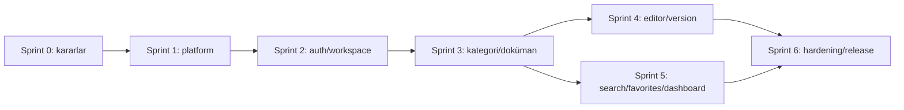

# Developer Wiki — Epic ve Sprint Planı

**Durum:** Sprint 6 uygulama işleri tamamlandı; release readiness iyileştirmeleri sürüyor
**Sürüm:** 0.1  
**Tarih:** 12 Ekim 2026

## Planlama varsayımları

Plan, 1 haftalık sprintler ve küçük ürün/mühendislik ekibi varsayımıyla bağımlılık sırasını gösterir; ekip kapasitesi ve kesin takvim verilmediği için tahmini efor taahhüt değildir. Önce çalışan dikey akış, sonra kapsam genişletme hedeflenir. Her sprint sonunda çalışan/demo edilebilir çıktı ve kabul kontrolü olmalıdır.

## Epic'ler

| ID  | Epic                         | Sonuç                                                                          |
| --- | ---------------------------- | ------------------------------------------------------------------------------ |
| E0  | Ürün ve mimari temeli        | PRD, ADR'ler, domain sınırları, monorepo ve yerel geliştirme standardı.        |
| E1  | Runtime ve platform          | Web/API iskeleti, config, DB/Redis/MinIO Compose, migration ve CI temel hattı. |
| E2  | Kimlik ve workspace          | Register/login/logout/refresh, workspace kurulumu, üyelik ve rol koruması.     |
| E3  | Kategori ve doküman          | Kategori/doküman CRUD, soft delete, Markdown editör ve sürüm geçmişi.          |
| E4  | Bulma ve kişisel çalışma     | Dashboard, FTS araması, favorites ve recent documents.                         |
| E5  | Kullanıcı deneyimi ve kalite | Landing, responsive/theme, profile, E2E/a11y ve hata/empty durumları.          |
| E6  | Production readiness         | Metrics/dashboard, hardening, backup/restore, deployment runbook ve release.   |

## Sprint 0 — Karar ve tasarım (ön koşul)

**Amaç:** Kod öncesi belirsizliği azaltmak.

- PRD, mimari ve bu sprint planını ürün sahibiyle gözden geçir.
- Workspace çoklu üyelik/davet, e-posta doğrulama/parola sıfırlama, kategori silme ve silinmiş slug kararlarını al.
- ADR-001 monorepo toolchain; ADR-002 auth/token/CSRF; ADR-003 tenant ve RBAC; ADR-004 soft delete/version/search; ADR-005 deployment başlangıç topolojisi.
- API error formatı, route prefix/versioning, pagination ve naming standardını belirle.
- UI akışlarını 12 ekranla eşleştir; davet ihtiyacı varsa ekran listesini güncelle.

**Kabul:** Açık karar sahipleri ve kararları yazılı; ilk dikey akış tanımlı; kapsam baz çizgisi onaylı. **Durum:** ADR-0001..0006 ile tamamlandı (2026-10-11).

## Sprint 1 — Monorepo ve çalışan yerel iskelet

**Amaç:** Tek komutla temel servisleri çalıştırıp web'den API sağlık durumunu görmek.

- Monorepo, package manager, lint/format/TypeScript config ve ortak scriptleri kur.
- Next.js web, Fastify API, Prisma, config validation ve structured logger iskeleti.
- Docker Compose: PostgreSQL, Redis, MinIO, Prometheus, Grafana; healthcheck ve volume.
- CI: install, lint, typecheck, build; env example ve kurulum dokümanı.

**Kabul:** Temiz checkout'tan belgelenmiş komutlarla servisler açılır; web/API healthcheck çalışır; secret repoda yok. **Durum:** Tamamlandı (2026-10-11). Lint, typecheck, build ve Compose config geçti; web/API container image'ları build edildi; Compose servisleri birlikte çalışıyor. Web, API, PostgreSQL ve Redis healthcheck'leri healthy; Prometheus API target'ı `up`; Grafana dashboard yüklü. Container image scan ve uygulama-testleri henüz yapılmadı.

## Sprint 2 — Kimlik ve workspace dikey akışı

**Amaç:** Register → workspace create → login/logout/refresh güvenli akışı.

- User, Workspace, WorkspaceMember, RefreshSession schema/migration.
- Auth route/schema/service/repository; password hash, token rotation, cookie, CSRF/origin ve rate limit.
- Workspace create ve üyelik bağlamı; merkezi auth/authorization preHandler.
- Login, Register ve Workspace Create arayüzleri; form hata/loading durumları.
- Unit/integration testler: parola, refresh reuse/rotation, anonymous erişim, tenant sınırı.

**Kabul:** Kullanıcı workspace oluşturur; korunan API üyeliği doğrular; logout token'ı geçersiz kılar. **Durum:** Tamamlandı (2026-10-11). Prisma migration uygulandı; register/login/logout/refresh rotasyonu ve replay koruması, ADMIN workspace oluşturma, CSRF, anonymous erişim ve tenant sınırı doğrulandı. API testleri 8/8 geçti; lint, typecheck, monorepo build ve Docker Compose smoke akışı başarılı.

## Sprint 3 — Kategori ve doküman çekirdeği

**Amaç:** Editor rolüyle kategori/doküman oluşturup okuyabilmek.

- Category/Document modelleri, migration ve indeksler.
- Modül katmanları (routes, services, repositories, schemas, dto, tests).
- Workspace-scoped CRUD, rol matrisi, soft delete ve pagination.
- Document List ve Category List/Create/Edit ekranları.
- Negatif tenant ve Reader yazma testleri.

**Kabul:** Editor belge yaratır/düzenler; Reader okuyabilir ama yazamaz; silinen içerik normal listede yoktur. **Durum:** Tamamlandı (2026-10-11). Category/Document migration ve partial unique slug indeksleri mevcut DB'ye uygulandı; tenant-scoped API CRUD, soft delete/pagination ve Category/Document liste arayüzleri eklendi; Editor yazma/Reader reddi/tenant sınırı testleri eklendi. 13/13 API testi, web/API typecheck, lint ve canlı health/readiness kontrolleri geçti. Tam monorepo production build'i son ortam çalışmasında pnpm 11/10 sürüm aktarımı ve ardından otomatik onay kullanım limiti nedeniyle doğrulanamadı.

## Sprint 4 — Editör ve sürüm geçmişi

**Amaç:** Güvenli Markdown düzenleme ve kayıpsız değişiklik geçmişi.

- DocumentVersion ve transactional save; optimistic concurrency.
- Markdown toolbar (H1-H3, bold, italic, code, link, bullet), güvenli render/sanitizasyon.
- Document Editor ekranı ve salt okunur sürüm geçmişi paneli.
- İçerik değişikliği, aynı içeriğin kaydı ve eşzamanlı edit testleri.

**Kabul:** Her anlamlı içerik değişikliği tek sürüm üretir; başarısız transaction kısmi durum bırakmaz; XSS payload güvenli render edilir. **Durum:** Tamamlandı (2026-10-11). `DocumentVersion` append-only tablosu ve `(documentId, version)` unique migration'ı uygulandı. İçerik farklıysa ana kayıt ve artan sürüm aynı transaction'da kaydediliyor; `expectedUpdatedAt` ile stale edit 409 oluyor. Başlık/Markdown editörü, H1-H3/biçim/kod bloğu/link/liste toolbar'ı, allowlist URL ve React escaped Markdown preview, salt okunur geçmiş paneli eklendi. API testleri 16/16 geçti; web/API typecheck ve lint geçti; Docker API/Web production build'i ve health kontrolleri başarılı.

## Sprint 5 — Dashboard, arama ve kişisel listeler

**Amaç:** İçeriği hızlı bulmak ve kişiselleştirmek.

- PostgreSQL FTS migration/query, workspace/deleted filtreleri ve snippet.
- Favorite ve RecentDocument repository/service/API.
- Dashboard son dokümanlar/son değişiklikler, Search, Favorites ekranları.
- Sıralama, limit, empty/no-results durumları ve tenant izolasyon testleri.

**Kabul:** Yetkili kullanıcı arar, favoriler ve son görüntülenenlerini görür; kullanıcı/workspace sınırı aşılmaz. **Durum:** Tamamlandı (2026-10-11). PostgreSQL `simple` FTS GIN indeksi, tenant/deleted filtreli parametrik arama ve snippet eklendi. Favorites/RecentDocument composite user-document ilişkileri, idempotent favorite upsert, recent upsert ve workspace-scoped listeler eklendi. Dashboard sayaçları, son güncellenen/son görüntülenen dokümanlar, Search ve Favorites ekranları tamamlandı. 21/21 API testi, API/Web typecheck ve lint geçti; Docker production build ve authenticated smoke akışı FTS/favorite/recent/dashboard üzerinde geçti.

## Sprint 6 — Tam UX, hardening ve release adayı

**Amaç:** 12 ekranı ve temel operasyonel kaliteyi tamamlamak.

- Landing, Profile, Logout/hesap menüsü; responsive sidebar ve dark/light tema.
- Form/empty/loading/error durumları, erişilebilirlik ve Playwright ana akışları.
- API metrics, Prometheus scrape, Grafana dashboard ve alert başlangıç eşikleri.
- Dependency/image security scan, production config, TLS/reverse proxy, secret ve backup/restore runbook.
- Staging deploy, migration/rollback tatbikatı, performans smoke ölçümü ve release checklist.

**Kabul:** CI yeşil; 12 ekran ana akışları tamam; production secrets güvenli; restore süreci denenmiş; bilinen riskler kayıtlı.

**Durum (2026-10-11):** Profile ekranı ve güvenli ad güncelleme API'si, workspace hesap menüsü/CSRF çıkış, light/dark tema tercihi, mobil üst gezinme, klavye odağı/skip link/reduced motion, dependency audit ve API/web image scan CI işleri ile backup/restore ve release checklist eklendi. Production kabulü açık: bu repoda staging/secret manager yok; gerçek TLS/prod secrets, off-host yedek ve restore tatbikatı, SLA/RPO/RTO, MinIO image kaynağı onayı ve staging performans smoke ölçümü yapılmadı. Bkz. `docs/release-checklist.md`.

**Release readiness devam işi (2026-10-11):** Digest-pinned image zorlamalı production Compose katmanı, Caddy TLS reverse proxy, production-only secret file injection, public port kapatma ve deployment runbook eklendi. Örnek test secret dosyalarıyla Compose config doğrulandı; tek yayımlanan servis Caddy oldu. Host deploy'u/Let's Encrypt issuance, gerçek secret manager, off-host yedek/restore tatbikatı ve SLA/RPO/RTO hâlâ operatör girdisi bekliyor. Bkz. `docs/operations/deployment.md` ve `docs/release-checklist.md`.

**Release readiness devam işi 2 (2026-10-11):** API/Web imajlarına image-level healthcheck, production Compose'u secret fixture'larıyla doğrulayan CI job'u ve staging deploy sonrası TLS/web/API/auth/DB readiness smoke script'i eklendi. Docker API/Web image builds ve API production compile başarılı; API testleri 21/21. Gerçek staging URL'si ve deploy yetkileri olmadığı için public smoke henüz çalıştırılmadı.

**Release readiness devam işi 3 (2026-10-11):** Prometheus API-down, yüksek 5xx oranı ve yüksek ortalama latency eşikleri; Grafana 5xx/latency panelleri ve CI `promtool` config/rule doğrulaması eklendi. Notification routing ve on-call ataması provider/operatör bilgisi gerektirdiği için açık bırakıldı. Bkz. `docs/operations/monitoring.md`.

**Release readiness devam işi 4 (2026-10-11):** Production Grafana/Prometheus erişimi için loopback-only Compose overlay ve SSH tunnel yönergesi, Alertmanager için provider-neutral receiver config örneği ve opt-in Compose katmanı eklendi. CI ana ve Alertmanager-enabled Compose konfigürasyonlarını kontrol eder. Gerçek receiver URL'si, Alertmanager image digest'i, SSH erişimi ve on-call sahibi operatör girdisi bekliyor.

**Release readiness devam işi 5 (2026-10-11):** PostgreSQL custom dump'ını hostta plaintext dosyaya yazmadan age ile şifreleyip S3 uyumlu off-host hedefe yükleyen, SHA-256 sidecar üreten ve iki nesnenin varlığını doğrulayan `scripts/backup-postgres-offsite.sh` eklendi. Linux systemd service/timer örnekleri ve backup/restore runbook'u şifreli akış, key ayrımı ve zamanlama kurulumunu anlatıyor. Git Bash `bash -n` ve sahte Docker/age/AWS komutlarıyla backup flow kontrolü geçti; Alertmanager ve ops erişim dahil production Compose config kontrolü geçti. Script henüz gerçek bucket/identity ile çalıştırılmadı; lifecycle, IAM, timer, MinIO nesne yedeği ve restore tatbikatı operatör ortamı bekliyor.

**Release readiness devam işi 6 (2026-10-11):** Incident response runbook'u, iletişim durumu şablonu, deploy rollback, veri olayı ve restore adımları eklendi. Release checklist şablonun varlığını tamamlanmış, owner/channel/update cadence ve incident plan onayını operatör girdisi olarak ayırıyor.

**Release readiness devam işi 7 (2026-10-11):** Playwright 1.64.0 root dev dependency olarak lockfile'a eklendi; Chromium CI job'u ve dört mock API tarayıcı senaryosu yazıldı: landing/register/workspace/dashboard, login/profile/theme/logout, category/document create-edit/version/favorite, search/favorites. Frozen lockfile install, E2E TypeScript kontrolü, format ve yerel Chromium koşusu (4/4) geçti. GitHub Actions job sonucu son push sonrasında doğrulanmalı; gerçek API/DB entegrasyonu API testlerinde kalıyor.

**Release readiness devam işi 8 (2026-10-11):** CI'daki checkout, setup-node ve Trivy action'ları resmi tag release commit SHA'larına pinlendi. Güncel workflow'da hareketli action tag'i kalmadı.

**Release readiness devam işi 9 (2026-10-11):** GitHub Actions run annotations, setup-node cache init sırasında `pnpm` executable'ının bulunamadığını ve Prometheus config job'unda container entrypoint'inin `promtool` olmadığını gösterdi. Workflow pnpm çağrılarını `corepack pnpm` biçimine aldı, setup-node pnpm cache probe'unu kaldırdı ve promtool'u açık entrypoint olarak çalıştırıyor. İki Prometheus config/rule kontrolü yerelde geçti; düzeltmeler push sonrası Actions'ta yeniden doğrulanmalı.

**Release readiness devam işi 10 (2026-10-11):** Son Actions run'ında Corepack ile pnpm install adımı Linux runner'da başarısız oldu; pnpm 10.9.0 resmi action ile kurulacak şekilde değiştirildi. Checkout/setup-node action'ları güncel Node 24 destekli release commit SHA'larına yükseltildi. API runtime imajı pnpm production deploy ağacını kullanıyor; migration CLI production bağımlılığına alındı ve Prisma'nın taramada kalan transitive paketleri patched sürümlere override edildi. Node runtime'ında kullanılmayan global npm/npx, API ve web runtime imajlarından kaldırıldı. Lokal API testleri (21/21), workspace typecheck/build, E2E typecheck ve browser senaryoları (4/4) geçti; API ve web production image taramalarında CRITICAL/HIGH bulgu kalmadı. GitHub Actions'ta yeniden doğrulama push sonrası bekliyor.

**Release readiness devam işi 11 (2026-10-11):** `69e8242` run'ında quality, Compose, monitoring ve browser E2E başarılı; Trivy API adımı genel exit-code hatası verdi ve annotation paket ayrıntısı içermedi. Son imaj Trivy 0.65.0, 0.69.3 ve 0.75.0 ile yerelde tarandı; CRITICAL/HIGH bulgu yok. CI Trivy action'ı güncel `v0.36.0` commit SHA'sına yükseltildi, scanner `0.75.0` ve 10 dakikalık timeout sabitlendi. Bu tarama sonucu yeni Actions run'ında doğrulanacak.

**Release readiness devam işi 12 (2026-10-11):** `51b9147` run'ında aynı API Trivy exit-code hatası tekrarlandı; diğer dört CI job'u geçti. CI action'ı için JSON raporu ve her iki imajı da özetleyen annotation adımı eklendi; sonraki run bulgu paketlerini veya rapor üretilmemesini gösterecek. Ayrıca disposable PostgreSQL 17 + MinIO ortamında gerçek script ile age şifreli dump, S3-compatible upload, checksum doğrulaması ve ayrı DB restore'u tamamlandı; 9 saniyelik süre tek satırlık fixture ölçümüdür ve RTO sayılmaz. Test kimlikleri, konteynerler ve geçici volume'lar tatbikat sonrası temizlendi.

**Release readiness devam işi 13 (2026-10-11):** Dört Prisma migration'ı disposable boş PostgreSQL 17 üzerinde uygulandı; `migrate deploy` ve ardından `migrate status` başarılı, schema up to date. Bu kontrol kalite CI job'una ephemeral PostgreSQL service ve clean-database migration step'i olarak eklendi. Staging snapshot yedeğiyle migration/rollback provası hâlâ gerçek staging verisi ve operatör prosedürü gerektiriyor.

**Release readiness devam işi 14 (2026-10-11):** `ad66d71` scan diagnostic adımı her iki Trivy raporunun da üretilmediğini gösterdi; Trivy setup input'unda release sürümü `v` önekiyle bekleniyor. Workflow `v0.75.0` biçimine düzeltildi. Sonraki Actions run'ında container-scan ve eklenen clean-database migration adımı doğrulanacak.

**Release readiness devam işi 15 (2026-10-12):** Release checklist ve CI workflow yayınlanan `master` ile karşılaştırıldı. `6e619cf` commit'ine ait Actions run `38168504143` başarıyla tamamlandı: quality (fresh PostgreSQL migration, dependency audit, API tests, lint, typecheck, build), browser E2E, API/web Trivy scan, production Compose ve monitoring config job'larının tümü yeşil. Güncel checklistte CI ve production Compose yapılandırma doğrulamaları tamamlandı; gerçek production registry digest'leri ve MinIO provenance kararı ayrı açık bırakıldı. Staging, secret manager, gerçek bucket/restore, host/TLS ve operasyon sahibi girdileri operatör ortamı bekliyor.

**Release readiness devam işi 16 (2026-10-12):** `scripts/smoke-deployment.sh` staging URL'si için HTTPS şemasını zorunlu kılar; curl istekleri TLS 1.2+ ve bağlantı/istek timeout'larıyla sınırlandırılır. Production Compose CI job'u script için `bash -n` kontrolü yapar. Bu değişiklik hostta gerçek TLS, auth ve readiness doğrulaması değildir; staging smoke maddesi açık kalır.\n\n**Release readiness devam işi 17 (2026-10-12):** `scripts/validate-production-config.sh` Compose config'i JSON olarak render edip yayımlı port politikasını denetliyor: Caddy için 80/443/443 dışında public port yok; diğer host portları varsa `127.0.0.1`'e bağlı. CI normal production ve ops-access/Alertmanager fixture'larını bu kuralla doğruluyor; backup, deployment smoke ve config validator shell syntax'ı da production config job'unda kontrol ediliyor. Run `38277681767` beş job'un tamamında başarılı. Gerçek staging smoke ve onaylı production image/MinIO provenance kararı hâlâ operatör girdisi gerektiriyor.\n\n**Release readiness devam işi 18 (2026-10-12):** Production port policy, `scripts/production-compose-ports.jq` filtresine çıkarıldı ve `validate-production-config.sh` tarafından rendered Compose JSON üzerinde uygulanıyor. CI, beklenen Caddy 80/443 portlarını ve 127.0.0.1 ops portunu kabul eden; wildcard-bound public API portunu reddeden allow/deny fixture'ları çalıştırıyor. Run `38278492697` beş job'un tamamında başarılı. Gerçek staging erişimi, production image/provenance onayı ve operasyon girdileri açık engel olmaya devam ediyor.\n\n**Release readiness devam işi 19 (2026-10-12):** Offsite backup script'i S3 hedef URI'sini bucket kısmı zorunlu olacak ve whitespace içermeyecek şekilde doğruluyor; boş bucket, HTTPS URI ve boşluklu hedef AWS CLI çağrılarından önce reddediliyor. Bu negatif senaryolar production config CI job'unda çalıştırıldı; run `38279633350` beş job'un tamamında başarılı. Gerçek bucket, IAM/lifecycle, production age recipient ve restore tatbikatı operatör ortamı bekliyor.\n\n**Release readiness devam işi 20 (2026-10-12):** Caddy reverse proxy baseline response security headers'ı (HSTS, nosniff, frame, referrer, permissions) ekliyor ve `Server` bilgisini kaldırıyor. `scripts/smoke-deployment.sh` gerçek HTTPS endpoint'inde bu beş header'ı zorunlu kontrol ediyor; CI syntax/quality/E2E/scan ve config job'ları run `38280873938` içinde başarılı. Gerçek staging URL'si olmadığından header kontrolünün canlı sonucu ve TLS issuance operatör ortamında doğrulanmalı. Deployment runbook güncellendi.\n\n## Story örnekleri

### E2-S1 — Kullanıcı hesabı açar

**Story:** Bir ekip üyesi olarak hesabımı oluşturmak istiyorum, böylece kendi workspace'imi başlatabilirim.

**Kabul kriterleri:** geçerli e-posta/parola şeması kabul edilir; parola hash'lenir; hatalar alan bazında gösterilir; duplicate email güvenli mesajla ele alınır; başarı sonrası oturum ve workspace onboarding oluşur.

### E2-S2 — Workspace oluşturur

**Story:** Yeni bir ekip olarak workspace açmak istiyorum, teknik bilgileri ortak yönetebileyim.

**Kabul kriterleri:** ad/slug doğrulanır; çakışma anlaşılır hata verir; oluşturucu Admin üyeliği alır; işlem atomiktir.

### E3-S1 — Doküman oluşturur

**Story:** Editor olarak kategori altında Markdown dokümanı oluşturmak istiyorum.

**Kabul kriterleri:** başlık zorunlu; kategori aynı workspace'e ait; oluşturucu/audit alanları set edilir; Reader için endpoint reddedilir.

### E3-S2 — Dokümanı günceller ve geçmişi görür

**Story:** Editor olarak güncel bilgiyi düzenleyip önceki sürümleri incelemek istiyorum.

**Kabul kriterleri:** güncelleme concurrency kontrolü taşır; içerik değişince transaction içinde bir version artar; Reader history okuyabilir; başka workspace belgesi erişime kapalıdır.

### E4-S1 — Doküman arar

**Story:** Üye olarak başlık veya içerikten arayıp doğru dokümana ulaşmak istiyorum.

**Kabul kriterleri:** minimum query uzunluğu/boş query kuralı belirlenir; sonuçlar üyelik kapsamındadır; soft deleted belgeler dönmez; sonuçlar sınırlandırılmıştır.

## Bağımlılık sırası

## Sürekli iş ve Definition of Done

Her story için: kabul kriterleri karşılanmış; tenant ve rol kontrolleri mevcut; schema validation ve güvenli hata yanıtları var; gerekli unit/integration/E2E testleri yazılmış (ilgili kapsamda); lint/typecheck/build başarılı; migration geriye dönük etkisi incelenmiş; dokümantasyon/README güncel; teknik borç ve gözlemlenebilirlik ihtiyacı kaydedilmiş; review edilebilir diff hazırlanmış.

## Teknik borç görünürlüğü

- İlk faz: davet/üyelik UX'i, email lifecycle, audit retention kararları.
- Veri: slug reuse ve kategori delete politikası; FTS dil/kalite optimizasyonu.
- Operasyon: tek host HA eksikliği, backup RPO/RTO ve restore tatbikatı, secret rotation.
- Ürün: workspace silme/export, versiyon restore, dosya ekleri, SSO ve gelişmiş yetki.

Sprint kapasitesi ve ilk implementasyon öncesi alınması gereken ürün kararları bilinmediği için tahmini takvim kesinleştirilmemiştir. Sprint 0 ADR kayıtları, Sprint 1 platform iskeleti, Sprint 2 auth/workspace akışı, Sprint 3 kategori/doküman çekirdeği, Sprint 4 editör/sürüm geçmişi ve Sprint 5 dashboard/arama/kişisel listeler tamamlandı. Sıradaki planlı iş Sprint 6'da tam UX, hardening ve release hazırlığıdır.

**Release readiness devam işi 21 (2026-10-12):** `.env.production.example` içindeki tüm production image referansları doğrulayıcının beklediği SHA-256 digest biçimine getirildi. Production Compose CI job'u örnek dosyadaki her `*_IMAGE` değerinin digest ile bittiğini denetliyor; böylece dokümante edilen güvenli varsayılan ve validator/CI beklentisi tutarlı. Yerel statik doğrulama 8/8 image referansının 64 karakterli digest biçiminde olduğunu ve CI invariant kontrolünün bulunduğunu gösterdi. GitHub connector bu commit'in push-triggered Actions durumunu listeleyemediği için yeni run sonucu burada doğrulanamadı. Gerçek image digest/provenance onayı yine operatör girdisidir.

**Release readiness devam işi 22 (2026-10-12):** `scripts/validate-production-config.sh` production secret dosyalarının mevcut, okunabilir, normal dosya ve boş olmadığını doğruluyor; `JWT_SECRET_FILE` uzunluğu 32 karakter altındaysa içerik göstermeden hata veriyor. Production Compose CI kısa JWT secret'ını reddetme ve geçerli fixture ile devam etme senaryolarını çalıştıracak şekilde güncellendi. Gerçek secret manager ve gerçek credential doğrulaması operatör ortamına bağlıdır; Actions push run durumu bu bağlantıda listelenemediğinden CI sonucu ayrıca doğrulanmalı.

**Release readiness devam işi 23 (2026-10-12):** `scripts/smoke-deployment.sh` deploy env dosyasındaki `ENABLE_OPS_UI` ve `ENABLE_ALERTMANAGER` seçimlerini okuyup aynı production Compose overlay'leriyle API readiness kontrolü yapıyor. CI smoke script'ini sahte curl/docker komutlarıyla, dış ağa bağlanmadan hem overlay'siz hem iki overlay birlikte senaryosunda doğrulayacak şekilde genişletildi. Bu otomatik senaryo canlı staging TLS/auth/readiness sonucunun yerine geçmez; Actions push sonucu da connector'dan görünür değil.

**Release readiness devam işi 24 (2026-10-12):** Production config validator, JWT secret dosyasını uygulamanın `trim()` davranışıyla aynı şekilde kırpıyor; böylece whitespace ile şişirilmiş kısa secret preflight'ten geçemiyor. Ayrıca uygulamanın reddettiği varsayılan local secret ve `replace-this` placeholder prefix'i deployment öncesi reddediliyor. CI kısa, whitespace ile şişirilmiş, local-default ve placeholder secret vakalarını reddedip geçerli fixture'ı kabul edecek şekilde kapsıyor. Gerçek credential rotasyonu/secret manager uygulaması operatör girdisi olmaya devam eder.

**Release readiness devam işi 25 (2026-10-12):** Production config validator deploy env dosyası için normal dosya/okunabilirlik şartı koyuyor. CI’da eksik secret yolu, boş secret dosyası ve dosya yerine dizin negatif senaryoları; hata çıktısında değerlerin gösterilmemesiyle birlikte kapsanıyor. Bu testlerin push-triggered run sonucu GitHub bağlantısından görünür değil.

**Release readiness devam işi 26 (2026-10-12):** CI preflight hata testleri, eksik JWT secret-file değişkeni ve bozuk image digest'ini sentinel değerlerle dener; doğrulayıcının ilgili değişken adını verip supplied value'yu hata çıktısına taşımadığını kontrol eder. Push-triggered Actions çalışmasının sonucu mevcut GitHub entegrasyonundan okunamadı.

**Release readiness devam işi 27 (2026-10-12):** Alertmanager overlay açıldığında config validator dosyanın normal/okunabilir ve boş olmayan config olmasını, reserved `.invalid` endpoint içermemesini ve aynı runtime release'inden `amtool` ile UTF-8 strict config check'ini şart koşuyor. CI amtool 0.34.1 release arşivini resmi SHA-256 checksum ile doğrulayarak kuruyor; valid `.test` receiver fixture'ını ve missing/empty/directory/reserved/invalid config negatif vakalarını kullanıyor. Bu statik/config doğrulaması gerçek webhook teslimat testi değildir.

**Release readiness devam işi 28 (2026-10-12):** Offsite backup systemd unit'i capability bounding set ve ambient capabilities'i boşaltacak, setuid/setgid kullanımını kapatacak ve UNIX/IPv4/IPv6 socket ailelerini allowlist edecek şekilde daraltıldı. Backup CI job'u bu privilege policy'yi statik olarak zorunlu kılıyor. Bu, servis sürecinin yerel Linux yetkilerini azaltır; Docker grubunun host root-equivalent daemon erişimini çözmez. Runbook bu sınırı ve rootless/backup-agent alternatifi netleştiriyor. Unit gerçek hostta çalıştırılmadığından systemd sürümü/daemon davranışı hedef işletim sisteminde ayrıca doğrulanmalı.

**Release readiness devam işi 29 (2026-10-12):** Backup service policy CI kapsamı satır eşleşmelerine ek olarak `systemd-analyze verify` ile Ubuntu runner üzerinde unit parser doğrulamasını çalıştıracak şekilde genişletildi. CI geçici bir unit kopyasında runner'a özgü çalışma dizini, env dosyası ve script yolunu kullanıyor; `User`/`Group` alanlarını runner kimlik veritabanına bağlı olduklarından parser kopyasından çıkarırken gerçek unit'teki değerleri ayrıca statik denetliyor. Bu check systemd unit syntax/config doğrulamasıdır; gerçek hostta servis ve Docker socket çalışma testi değildir.

**Release readiness devam işi 30 (2026-10-12):** Backup systemd unit'inin `ExecStart` satırı, çalışma ağacında executable bit'i bulunmayan shell script'i doğrudan başlattığı için erişim hatasına yol açabilirdi. Unit `/usr/bin/bash` ile açıkça çağıracak şekilde düzeltildi; CI tam komut satırını kontrol ediyor ve systemd parser fixture'ında script yolunu runner workspace'ine uyarlıyor. Hostta unit/service kullanıcısı ile Docker socket erişimi ayrıca doğrulanmalı.

**Release readiness devam işi 31 (2026-10-12):** Monitoring runbook'u mevcut optional Alertmanager overlay'iyle tutarlı hâle getirildi. Monitoring CI job'u Prometheus config/rule doğrulamasına ek olarak Grafana dashboard JSON'unda UID, dört beklenen panel ve her panelde PromQL target invariant'larını denetliyor; datasource/provider provisioning yolları da kontrol ediliyor. Bu statik doğrulama Grafana'nın canlı provision edildiğini veya Alertmanager webhook'unun teslim edildiğini kanıtlamaz.

**Release readiness devam işi 32 (2026-10-12):** Backup timer için CI, `OnCalendar`, rastgele gecikme, missed-run persistence ve service binding alanlarını statik denetliyor; systemd-analyze calendar ifadesinin sözdizimini doğruluyor. Bu kontrol seçilen 02:15 örneğinin kurum RPO/bakım penceresine uygunluğunu doğrulamaz; zamanlama hâlâ operatör onayı bekler.

**Release readiness devam işi 33 (2026-10-12):** Offsite backup yüklemesinden sonra script artık S3 `ContentLength` değerini yerel şifreli dump ve checksum sidecar boyutlarıyla karşılaştırıyor; sayısal olmayan veya farklı boyut hatayla duruyor. CI fake Docker/age/AWS CLI'larla başarılı yükleme ve boyut mismatch reddini çalıştıracak şekilde genişletildi. Boyut eşleşmesi tek başına içerik checksum/restore doğrulaması değildir; gerçek off-host restore tatbikatı yine gereklidir.

**Release readiness devam işi 34 (2026-10-12):** Production Compose port policy artık yalnız container target portlarını değil, Caddy'nin public host port/protocol eşleşmesini de tam olarak 80/tcp, 443/tcp ve 443/udp ile sınırlandırıyor. CI beklenen Caddy ve loopback operations fixture'larını kabul ediyor; public API portu ve Caddy 8080 alternatifini reddediyor. Bu, published host portlarını kapsar; gerçek firewall ve host network doğrulaması yine staging'de yapılmalıdır.

**Release readiness devam işi 35 (2026-10-12):** Docker Compose 5.3.1 ile production stack ve operations overlay gerçek config renderer'ında çalıştırıldı. Base prod config Caddy için 80/tcp, 443/tcp ve 443/udp eşleşmelerini, başka servislerde public host publish olmadığını verdi; operations overlay aynı Caddy eşleşmelerini koruyup Grafana/Prometheus'u 127.0.0.1'e bağladı. Bu yerel config render'dır; policy JQ filtresi GitHub Actions'ta henüz yeşil run ile doğrulanmadı ve host firewall/staging davranışını kanıtlamaz.
