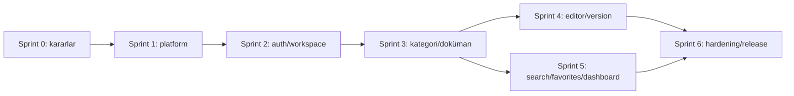

# Developer Wiki — Epic ve Sprint Planı

**Durum:** Sprint 6 uygulama işleri tamamlandı; release readiness iyileştirmeleri sürüyor
**Sürüm:** 0.1  
**Tarih:** 11 Ekim 2026

## Planlama varsayımları

Plan, 1 haftalık sprintler ve küçük ürün/mühendislik ekibi varsayımıyla bağımlılık sırasını gösterir; ekip kapasitesi ve kesin takvim verilmediği için tahmini efor taahhüt değildir. Önce çalışan dikey akış, sonra kapsam genişletme hedeflenir. Her sprint sonunda çalışan/demo edilebilir çıktı ve kabul kontrolü olmalıdır.

## Epic'ler

| ID  | Epic                         | Sonuç                                                                          |
| --- | ---------------------------- | ------------------------------------------------------------------------------ |
| E0  | Ürün ve mimari temeli        | PRD, ADR'ler, domain sınırları, monorepo ve yerel geliştirme standardı.        |
| E1  | Runtime ve platform          | Web/API iskeleti, config, DB/Redis/MinIO Compose, migration ve CI temel hattı. |
| E2  | Kimlik ve workspace          | Register/login/logout/refresh, workspace kurulumu, üyelik ve rol koruması.     |
| E3  | Kategori ve doküman          | Kategori/doküman CRUD, soft delete, Markdown editör ve sürüm geçmişi.          |
| E4  | Bulma ve kişisel çalışma     | Dashboard, FTS araması, favorites ve recent documents.                         |
| E5  | Kullanıcı deneyimi ve kalite | Landing, responsive/theme, profile, E2E/a11y ve hata/empty durumları.          |
| E6  | Production readiness         | Metrics/dashboard, hardening, backup/restore, deployment runbook ve release.   |

## Sprint 0 — Karar ve tasarım (ön koşul)

**Amaç:** Kod öncesi belirsizliği azaltmak.

- PRD, mimari ve bu sprint planını ürün sahibiyle gözden geçir.
- Workspace çoklu üyelik/davet, e-posta doğrulama/parola sıfırlama, kategori silme ve silinmiş slug kararlarını al.
- ADR-001 monorepo toolchain; ADR-002 auth/token/CSRF; ADR-003 tenant ve RBAC; ADR-004 soft delete/version/search; ADR-005 deployment başlangıç topolojisi.
- API error formatı, route prefix/versioning, pagination ve naming standardını belirle.
- UI akışlarını 12 ekranla eşleştir; davet ihtiyacı varsa ekran listesini güncelle.

**Kabul:** Açık karar sahipleri ve kararları yazılı; ilk dikey akış tanımlı; kapsam baz çizgisi onaylı. **Durum:** ADR-0001..0006 ile tamamlandı (2026-10-11).

## Sprint 1 — Monorepo ve çalışan yerel iskelet

**Amaç:** Tek komutla temel servisleri çalıştırıp web'den API sağlık durumunu görmek.

- Monorepo, package manager, lint/format/TypeScript config ve ortak scriptleri kur.
- Next.js web, Fastify API, Prisma, config validation ve structured logger iskeleti.
- Docker Compose: PostgreSQL, Redis, MinIO, Prometheus, Grafana; healthcheck ve volume.
- CI: install, lint, typecheck, build; env example ve kurulum dokümanı.

**Kabul:** Temiz checkout'tan belgelenmiş komutlarla servisler açılır; web/API healthcheck çalışır; secret repoda yok. **Durum:** Tamamlandı (2026-10-11). Lint, typecheck, build ve Compose config geçti; web/API container image'ları build edildi; Compose servisleri birlikte çalışıyor. Web, API, PostgreSQL ve Redis healthcheck'leri healthy; Prometheus API target'ı `up`; Grafana dashboard yüklü. Container image scan ve uygulama-testleri henüz yapılmadı.

## Sprint 2 — Kimlik ve workspace dikey akışı

**Amaç:** Register → workspace create → login/logout/refresh güvenli akışı.

- User, Workspace, WorkspaceMember, RefreshSession schema/migration.
- Auth route/schema/service/repository; password hash, token rotation, cookie, CSRF/origin ve rate limit.
- Workspace create ve üyelik bağlamı; merkezi auth/authorization preHandler.
- Login, Register ve Workspace Create arayüzleri; form hata/loading durumları.
- Unit/integration testler: parola, refresh reuse/rotation, anonymous erişim, tenant sınırı.

**Kabul:** Kullanıcı workspace oluşturur; korunan API üyeliği doğrular; logout token'ı geçersiz kılar. **Durum:** Tamamlandı (2026-10-11). Prisma migration uygulandı; register/login/logout/refresh rotasyonu ve replay koruması, ADMIN workspace oluşturma, CSRF, anonymous erişim ve tenant sınırı doğrulandı. API testleri 8/8 geçti; lint, typecheck, monorepo build ve Docker Compose smoke akışı başarılı.

## Sprint 3 — Kategori ve doküman çekirdeği

**Amaç:** Editor rolüyle kategori/doküman oluşturup okuyabilmek.

- Category/Document modelleri, migration ve indeksler.
- Modül katmanları (routes, services, repositories, schemas, dto, tests).
- Workspace-scoped CRUD, rol matrisi, soft delete ve pagination.
- Document List ve Category List/Create/Edit ekranları.
- Negatif tenant ve Reader yazma testleri.

**Kabul:** Editor belge yaratır/düzenler; Reader okuyabilir ama yazamaz; silinen içerik normal listede yoktur. **Durum:** Tamamlandı (2026-10-11). Category/Document migration ve partial unique slug indeksleri mevcut DB'ye uygulandı; tenant-scoped API CRUD, soft delete/pagination ve Category/Document liste arayüzleri eklendi; Editor yazma/Reader reddi/tenant sınırı testleri eklendi. 13/13 API testi, web/API typecheck, lint ve canlı health/readiness kontrolleri geçti. Tam monorepo production build'i son ortam çalışmasında pnpm 11/10 sürüm aktarımı ve ardından otomatik onay kullanım limiti nedeniyle doğrulanamadı.

## Sprint 4 — Editör ve sürüm geçmişi

**Amaç:** Güvenli Markdown düzenleme ve kayıpsız değişiklik geçmişi.

- DocumentVersion ve transactional save; optimistic concurrency.
- Markdown toolbar (H1-H3, bold, italic, code, link, bullet), güvenli render/sanitizasyon.
- Document Editor ekranı ve salt okunur sürüm geçmişi paneli.
- İçerik değişikliği, aynı içeriğin kaydı ve eşzamanlı edit testleri.

**Kabul:** Her anlamlı içerik değişikliği tek sürüm üretir; başarısız transaction kısmi durum bırakmaz; XSS payload güvenli render edilir. **Durum:** Tamamlandı (2026-10-11). `DocumentVersion` append-only tablosu ve `(documentId, version)` unique migration'ı uygulandı. İçerik farklıysa ana kayıt ve artan sürüm aynı transaction'da kaydediliyor; `expectedUpdatedAt` ile stale edit 409 oluyor. Başlık/Markdown editörü, H1-H3/biçim/kod bloğu/link/liste toolbar'ı, allowlist URL ve React escaped Markdown preview, salt okunur geçmiş paneli eklendi. API testleri 16/16 geçti; web/API typecheck ve lint geçti; Docker API/Web production build'i ve health kontrolleri başarılı.

## Sprint 5 — Dashboard, arama ve kişisel listeler

**Amaç:** İçeriği hızlı bulmak ve kişiselleştirmek.

- PostgreSQL FTS migration/query, workspace/deleted filtreleri ve snippet.
- Favorite ve RecentDocument repository/service/API.
- Dashboard son dokümanlar/son değişiklikler, Search, Favorites ekranları.
- Sıralama, limit, empty/no-results durumları ve tenant izolasyon testleri.

**Kabul:** Yetkili kullanıcı arar, favoriler ve son görüntülenenlerini görür; kullanıcı/workspace sınırı aşılmaz. **Durum:** Tamamlandı (2026-10-11). PostgreSQL `simple` FTS GIN indeksi, tenant/deleted filtreli parametrik arama ve snippet eklendi. Favorites/RecentDocument composite user-document ilişkileri, idempotent favorite upsert, recent upsert ve workspace-scoped listeler eklendi. Dashboard sayaçları, son güncellenen/son görüntülenen dokümanlar, Search ve Favorites ekranları tamamlandı. 21/21 API testi, API/Web typecheck ve lint geçti; Docker production build ve authenticated smoke akışı FTS/favorite/recent/dashboard üzerinde geçti.

## Sprint 6 — Tam UX, hardening ve release adayı

**Amaç:** 12 ekranı ve temel operasyonel kaliteyi tamamlamak.

- Landing, Profile, Logout/hesap menüsü; responsive sidebar ve dark/light tema.
- Form/empty/loading/error durumları, erişilebilirlik ve Playwright ana akışları.
- API metrics, Prometheus scrape, Grafana dashboard ve alert başlangıç eşikleri.
- Dependency/image security scan, production config, TLS/reverse proxy, secret ve backup/restore runbook.
- Staging deploy, migration/rollback tatbikatı, performans smoke ölçümü ve release checklist.

**Kabul:** CI yeşil; 12 ekran ana akışları tamam; production secrets güvenli; restore süreci denenmiş; bilinen riskler kayıtlı.

**Durum (2026-10-11):** Profile ekranı ve güvenli ad güncelleme API'si, workspace hesap menüsü/CSRF çıkış, light/dark tema tercihi, mobil üst gezinme, klavye odağı/skip link/reduced motion, dependency audit ve API/web image scan CI işleri ile backup/restore ve release checklist eklendi. Production kabulü açık: bu repoda staging/secret manager yok; gerçek TLS/prod secrets, off-host yedek ve restore tatbikatı, SLA/RPO/RTO, MinIO image kaynağı onayı ve staging performans smoke ölçümü yapılmadı. Bkz. `docs/release-checklist.md`.

**Release readiness devam işi (2026-10-11):** Digest-pinned image zorlamalı production Compose katmanı, Caddy TLS reverse proxy, production-only secret file injection, public port kapatma ve deployment runbook eklendi. Örnek test secret dosyalarıyla Compose config doğrulandı; tek yayımlanan servis Caddy oldu. Host deploy'u/Let's Encrypt issuance, gerçek secret manager, off-host yedek/restore tatbikatı ve SLA/RPO/RTO hâlâ operatör girdisi bekliyor. Bkz. `docs/operations/deployment.md` ve `docs/release-checklist.md`.

**Release readiness devam işi 2 (2026-10-11):** API/Web imajlarına image-level healthcheck, production Compose'u secret fixture'larıyla doğrulayan CI job'u ve staging deploy sonrası TLS/web/API/auth/DB readiness smoke script'i eklendi. Docker API/Web image builds ve API production compile başarılı; API testleri 21/21. Gerçek staging URL'si ve deploy yetkileri olmadığı için public smoke henüz çalıştırılmadı.

**Release readiness devam işi 3 (2026-10-11):** Prometheus API-down, yüksek 5xx oranı ve yüksek ortalama latency eşikleri; Grafana 5xx/latency panelleri ve CI `promtool` config/rule doğrulaması eklendi. Notification routing ve on-call ataması provider/operatör bilgisi gerektirdiği için açık bırakıldı. Bkz. `docs/operations/monitoring.md`.

**Release readiness devam işi 4 (2026-10-11):** Production Grafana/Prometheus erişimi için loopback-only Compose overlay ve SSH tunnel yönergesi, Alertmanager için provider-neutral receiver config örneği ve opt-in Compose katmanı eklendi. CI ana ve Alertmanager-enabled Compose konfigürasyonlarını kontrol eder. Gerçek receiver URL'si, Alertmanager image digest'i, SSH erişimi ve on-call sahibi operatör girdisi bekliyor.

## Story örnekleri

### E2-S1 — Kullanıcı hesabı açar

**Story:** Bir ekip üyesi olarak hesabımı oluşturmak istiyorum, böylece kendi workspace'imi başlatabilirim.

**Kabul kriterleri:** geçerli e-posta/parola şeması kabul edilir; parola hash'lenir; hatalar alan bazında gösterilir; duplicate email güvenli mesajla ele alınır; başarı sonrası oturum ve workspace onboarding oluşur.

### E2-S2 — Workspace oluşturur

**Story:** Yeni bir ekip olarak workspace açmak istiyorum, teknik bilgileri ortak yönetebileyim.

**Kabul kriterleri:** ad/slug doğrulanır; çakışma anlaşılır hata verir; oluşturucu Admin üyeliği alır; işlem atomiktir.

### E3-S1 — Doküman oluşturur

**Story:** Editor olarak kategori altında Markdown dokümanı oluşturmak istiyorum.

**Kabul kriterleri:** başlık zorunlu; kategori aynı workspace'e ait; oluşturucu/audit alanları set edilir; Reader için endpoint reddedilir.

### E3-S2 — Dokümanı günceller ve geçmişi görür

**Story:** Editor olarak güncel bilgiyi düzenleyip önceki sürümleri incelemek istiyorum.

**Kabul kriterleri:** güncelleme concurrency kontrolü taşır; içerik değişince transaction içinde bir version artar; Reader history okuyabilir; başka workspace belgesi erişime kapalıdır.

### E4-S1 — Doküman arar

**Story:** Üye olarak başlık veya içerikten arayıp doğru dokümana ulaşmak istiyorum.

**Kabul kriterleri:** minimum query uzunluğu/boş query kuralı belirlenir; sonuçlar üyelik kapsamındadır; soft deleted belgeler dönmez; sonuçlar sınırlandırılmıştır.

## Bağımlılık sırası

## Sürekli iş ve Definition of Done

Her story için: kabul kriterleri karşılanmış; tenant ve rol kontrolleri mevcut; schema validation ve güvenli hata yanıtları var; gerekli unit/integration/E2E testleri yazılmış (ilgili kapsamda); lint/typecheck/build başarılı; migration geriye dönük etkisi incelenmiş; dokümantasyon/README güncel; teknik borç ve gözlemlenebilirlik ihtiyacı kaydedilmiş; review edilebilir diff hazırlanmış.

## Teknik borç görünürlüğü

- İlk faz: davet/üyelik UX'i, email lifecycle, audit retention kararları.
- Veri: slug reuse ve kategori delete politikası; FTS dil/kalite optimizasyonu.
- Operasyon: tek host HA eksikliği, backup RPO/RTO ve restore tatbikatı, secret rotation.
- Ürün: workspace silme/export, versiyon restore, dosya ekleri, SSO ve gelişmiş yetki.

Sprint kapasitesi ve ilk implementasyon öncesi alınması gereken ürün kararları bilinmediği için tahmini takvim kesinleştirilmemiştir. Sprint 0 ADR kayıtları, Sprint 1 platform iskeleti, Sprint 2 auth/workspace akışı, Sprint 3 kategori/doküman çekirdeği, Sprint 4 editör/sürüm geçmişi ve Sprint 5 dashboard/arama/kişisel listeler tamamlandı. Sıradaki planlı iş Sprint 6'da tam UX, hardening ve release hazırlığıdır.
