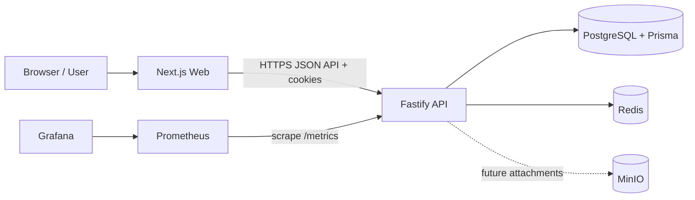
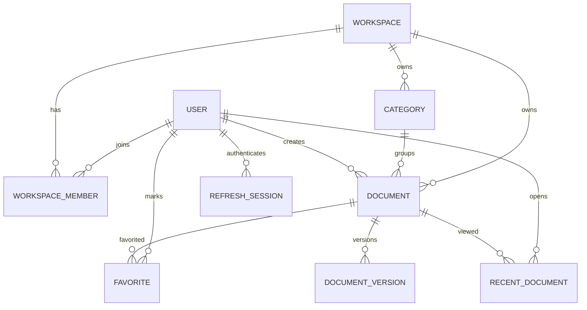

# Developer Wiki — Sistem Mimarisi

**Durum:** İlk uygulama öncesi taslak  
**Sürüm:** 0.1  
**Tarih:** 11 Ekim 2026

## 1. Mimari hedefler

MVP'yi tek ekipçe geliştirilebilir, tenant sınırları belirgin, yerelde Docker Compose ile çalıştırılabilir ve ileride bağımsız ölçeklenebilir kurmak. Başlangıçta mikroservisler, Elasticsearch ve dağıtık olay altyapısı eklenmez.

## 2. Seçilen yaklaşım

Modüler monorepo ve modüler monolit API: web ve API ayrı uygulamalar; Fastify API içinde domain modülleri; PostgreSQL kalıcı ana veri kaynağı. Redis rate limit/geçici cache için; MinIO S3 uyumlu nesne depolama için hazır tutulur ancak dosya eki MVP dışındadır. Prometheus metrik toplar, Grafana panoları sunar.

### Alternatifler

| Karar | Seçim | Alternatif | Neden / maliyet |
|---|---|---|---|
| Dağıtım birimi | Modüler monolit | Mikroservis | MVP'de tek transaction ve basit yerel çalışma önemli; modül sınırları servis ayrımına kapı bırakır. |
| Arama | PostgreSQL FTS | Elasticsearch | Daha az altyapı ve tutarlı tenant sorgusu; dil/ölçek ihtiyaçları büyüyünce yeniden değerlendir. |
| ORM erişimi | Prisma repository üzerinden | Route içinde Prisma | İş kurallarını ve sorgu detayını katmanlardan ayırır; test edilebilirlik sağlar. |
| Auth oturumu | JWT + HttpOnly cookie, refresh rotasyonu | Local storage token / yalnız server session | Browser script erişimini azaltır, API gereksinimini karşılar; CSRF/origin koruması gerekir. |
| Deploy | Docker Compose ile tek Ubuntu host başlangıcı | Kubernetes | Operasyon yükünü MVP seviyesinde tutar; tek host HA sağlamaz. |
| UI | Next.js/React/TS/Tailwind/shadcn | Ayrı SPA framework'ü | Verilen stack ile hızlı sayfa/tema ve ortak UI geliştirme. |

## 3. Bağlam ve bileşen diyagramı



Web yalnız API sözleşmesi üzerinden iş yapar. API kimlik, yetki, doğrulama ve domain kurallarının otoritesidir. PostgreSQL tenant'a ait verinin ve sürüm geçmişinin kaynağıdır. MinIO yapılandırılır fakat ilk sürümde belge ekleri sunulmaz.

## 4. Monorepo taslağı

```text
DeveloperWiki/
├── .github/workflows/ci.yml    # Lint, typecheck ve build pipeline
├── apps/
│   ├── web/                    # Next.js ekranları, route grupları ve web API istemcisi
│   └── api/                    # Fastify bootstrap ve modüler HTTP API
├── docs/
│   ├── product-requirements.md
│   ├── system-architecture.md
│   ├── sprint-plan.md
│   └── adr/                    # Mimari karar kayıtları
├── infrastructure/
│   ├── docker/                 # Compose ve servis Dockerfile'ları
│   ├── monitoring/             # Prometheus/Grafana config ve dashboard provisioning
│   └── deployment/             # Ubuntu kurulum/operasyon dosyaları
├── packages/
│   ├── ui/                     # Paylaşılan erişilebilir UI bileşenleri
│   ├── shared/                 # Platformdan bağımsız yardımcılar/sözleşme sabitleri
│   └── types/                  # API DTO ve ortak tipler; runtime schema kaynağı ayrıca kararlaştırılır
├── .env.example                # Yerel geliştirme değişkenleri (gerçek secret içermez)
├── .dockerignore
├── .gitignore
├── .node-version               # Node runtime standardı
├── .npmrc
├── package.json                # Workspace scripts ve package manager metadata
├── pnpm-lock.yaml              # Tekrarlanabilir dependency graph
├── pnpm-workspace.yaml         # pnpm workspace üyeleri
├── tsconfig.base.json
└── turbo.json                  # Monorepo task graph/cache ayarları
```

Package manager ve task runner pnpm workspace + Turborepo olarak seçildi (ADR-0001). Node.js 22 LTS ve pnpm 10.9 standardı `.node-version` ve root `package.json` içinde sabitlenir.

## 5. API iç mimarisi

```text
apps/api/src/
├── app.ts                      # Fastify instance, plugin ve modül kayıtları
├── server.ts                   # Config yükleme ve listener lifecycle
├── plugins/                    # Prisma, Redis, auth, rate limit, metrics, error handler
├── shared/                     # Request context, logger, errors, pagination ve ortak şemalar
└── modules/
    ├── auth/{routes,services,repositories,schemas,dto,tests}
    ├── workspace/{routes,services,repositories,schemas,dto,tests}
    ├── category/{routes,services,repositories,schemas,dto,tests}
    ├── document/{routes,services,repositories,schemas,dto,tests}
    └── search/{routes,services,repositories,schemas,dto,tests}
```

Route: HTTP parse/response ve schema. Service: iş kuralları ve transaction sınırı. Repository: Prisma sorguları; her workspace sorgusunda doğrulanmış `workspaceId` zorunlu. Schema: request/response runtime doğrulaması. DTO: dış API biçimi. Domain modülleri birbirlerinin Prisma modellerine doğrudan erişmez; servis veya açık repository portu üzerinden iletişim kurar.

## 6. Veri modeli taslağı



Çekirdek tablolar: `User`, `Workspace`, `WorkspaceMember`, `Category`, `Document`, `DocumentVersion`, `Favorite`, `RecentDocument`, `RefreshSession`, gerekirse `AuditLog`. Tenant verilerinde standart `createdAt`, `updatedAt`, `deletedAt` alanları; silinmeyen bağlantı tablolarında uygun unique constraint'ler kullanılır. Version kayıtları append-only'dir. Her kullanıcı çoklu workspace üyeliğine sahip olabilir; ilk MVP'de davet UI'si kapsam dışıdır. Soft delete edilmiş slug yeniden kullanılabilir; aktif kayıtlar partial unique index ile korunur. Kararlar ADR-0002 ve ADR-0004'te kayıtlıdır.

### Önemli bütünlük kuralları

- `(workspaceId, slug)` workspace içindeki kategoriler ve dokümanlar için benzersiz olmalıdır; soft delete ile slug yeniden kullanımı politikası ayrıca tanımlanır.
- Dokümanın kategorisi varsa aynı workspace'e ait olmalıdır. DB FK veya service doğrulamasıyla çapraz workspace ilişki engellenir.
- `DocumentVersion` için `(documentId, version)` unique olur.
- Favoride `(userId, documentId)`, recent kaydında `(userId, documentId)` unique olur.
- Silme sırasında FK davranışı açıkça belirlenir; doküman kategorisi silme semantiği cascade ile sessiz veri kaybına bırakılmaz.

## 7. Auth ve güvenlik akışı

1. Login parolayı doğrular, refresh session özeti oluşturur ve access JWT / opaque refresh token değerlerini HttpOnly cookie'lere yazar.
2. Korunan istek auth hook ile access token'ı doğrular; sonra workspace üyeliği ve rolü doğrulanır.
3. Access süresi bitince refresh endpoint'i geçerli refresh token'ı döndürür, eskisini iptal eder; tekrar kullanım şüphesinde session iptal edilir.
4. Logout refresh session'ı iptal eder ve cookie'leri temizler.

Cookie ayarları HTTPS'te `Secure`, `HttpOnly`, `SameSite=Lax`; origin doğrulaması ve CSRF token koruması yazma isteklerinde uygulanır. Refresh token özeti saklanır ve rotasyon yapılır; parola Argon2id ile hash'lenir (ADR-0003). Secret'lar environment/secret store'dan gelir, repoya konmaz. Şema doğrulama, boyut sınırları, rate limit, güvenli CORS allowlist'i, Markdown sanitizasyonu, yapılandırılmış ve hassas veri içermeyen log standarttır. Audit log kapsamı (rol değişikliği, silme, auth olayları) MVP gereksinimine göre minimize edilir.

## 8. Ana veri akışları

### Doküman kaydetme

İstek doğrula → access token doğrula → workspace role kontrol et → service optimistic concurrency kontrolü → transaction içinde Document güncelle ve DocumentVersion ekle → response DTO. İçerik değişmediyse yeni sürüm oluşturulmaması tercih edilir; ürün kararı testlerle sabitlenmelidir.

### Arama

İstek doğrula → workspace üyeliğini doğrula → PostgreSQL `tsvector`/`tsquery` ile `simple` konfigürasyonu ve parametrik SQL → `workspaceId`, aktif doküman ve aktif kategori filtreleri → sınırlı sıralı sonuç ve snippet. Başlık/içerik GIN indeksi ve ağırlıkları migration ile kurulur (ADR-0005).

## 9. Web navigasyonu

- Public: Landing, Login, Register.
- Onboarding: Workspace Create.
- Authenticated app: Dashboard, Category List/Create/Edit, Document List/Editor, Search, Favorites, Profile.
- Sol sidebar: Dashboard, Categories, Favorites, Search; workspace seçici ve kullanıcı menüsü. İçerik sağ panelde. Mobilde sidebar drawer olur.
- Server/client sınırlarında auth bilgisi token sızdırmadan yönetilir; private sayfalar API yetkisinin yerine geçmez.

## 10. Çalıştırma, CI ve operasyon

Compose servisleri: web, api, PostgreSQL, Redis, MinIO, Prometheus, Grafana. Yerel ortamda başlangıç parolaları yalnız dev amaçlıdır. Healthcheck, named volumes, internal network ve kaynak konfigürasyonu eklenir. Production secret, TLS reverse proxy, firewall ve yedekleme Compose dosyasından ayrı operasyon konfigürasyonunda belirlenir.

GitHub Actions: install/cache → lint → unit/integration test → build → container build → dependency/image security scan. Deploy adımı ortam, secret ve rollback prosedürü netleşmeden etkinleştirilmez. PostgreSQL yedekleme ve geri yükleme testi; Redis/MinIO kalıcılık gereksinimleri production öncesi belgelenir.

API `/metrics` üzerinden request count, status sınıfı/error rate ve latency histogram sağlar; health/readiness endpoint'leri dependency durumunu uygun şekilde raporlar. Prometheus scrape eder; Grafana dashboard provisioning repo içindedir. Metric label'larında user/document/workspace gibi yüksek cardinality veya hassas veri kullanılmaz.

## 11. Test stratejisi

- Unit (Vitest): domain hizmetleri, yetki kuralları, slug/versiyon kararları.
- Integration (Vitest + test PostgreSQL): repository, transaction, FTS, tenant izolasyonu, migration.
- API contract: Fastify inject ile şema/HTTP hata ve rol kontrolleri.
- E2E (Playwright): kayıt → workspace → kategori → doküman → arama/favori akışları ve Reader kısıtları.
- Testler gerçek servis bağımlılıklarını izole eder; CI'da migration başlangıçtan uygulanır.

## 12. Teknik borç ve ertelenen kararlar

- Workspace davet ve üyelik yönetiminin UX/API kapsamı (MVP dışında, sonraki ürün kararı).
- E-posta doğrulama, parola sıfırlama ve refresh-session cihaz yönetimi.
- FTS dil konfigürasyonu, stemming ve sıralama kalitesi.
- Audit log retention/erişim politikası.
- Tek host için RPO/RTO, offsite backup ve disaster recovery.
- MinIO'yu MVP Compose'a dahil etme gerekçesi ek dosyalar başlamadan doğrulanmalı.
- Upstream MinIO container registry erişimi ve yerel geliştirme mirror'ının production uygunluğu.
- Ortak API schema paylaşım modeli.

## 13. Sonraki adım

Sprint 0 kararları ADR-0001..0006 ile kaydedildi. Sprint 1 iskeleti oluşturuldu; sonraki adım Prisma/domain şeması ve ilk auth-workspace dikey akışıdır. Ürün kararı gerektiren e-posta yaşam döngüsü, audit retention ve production RPO/RTO maddeleri açık kalır.
